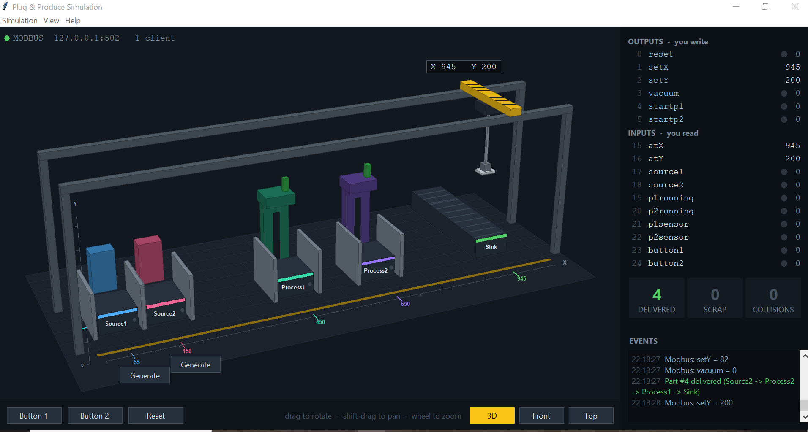
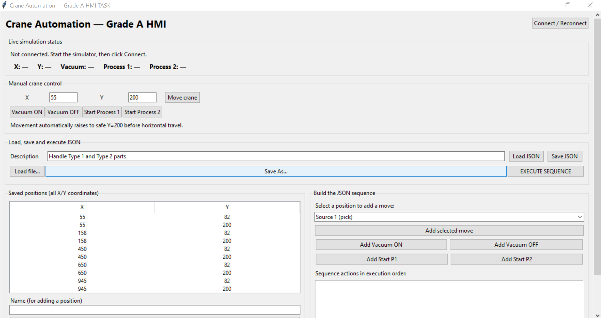

# Plug-and-Produce Crane Automation System

A Python-based industrial automation project implementing an automated crane system for intelligent material handling, multi-product routing, and production process coordination.

Developed as part of the **Master's Programme in AI and Automation at University West, Sweden**, this project demonstrates the integration of Python programming, industrial communication, automation logic, process monitoring, and Human-Machine Interface (HMI) development.

---

## Project Overview

The project focuses on developing a Plug-and-Produce crane automation system capable of handling different product types and coordinating their movement between multiple production stations.

The crane communicates with an industrial simulation environment through **Modbus TCP**. A Python-based controller manages crane movements, product handling, process coordination, and communication with the simulated production environment.

The system also includes a graphical Human-Machine Interface (HMI) developed using Tkinter, allowing interaction with and monitoring of the automation process.

The objective was to develop an integrated automation solution that can handle different production workflows while maintaining reliable communication and product tracking.

## Key Features

- **Industrial Communication:** Modbus TCP communication between the Python application and the crane simulation.
- **Automated Crane Movement:** Control of horizontal (X-axis) and vertical (Y-axis) positioning.
- **Vacuum-Based Material Handling:** Automated product picking and releasing.
- **Multi-Product Handling:** Support for Type 1 and Type 2 products with different production routes.
- **Production Coordination:** Coordination between multiple processing stations.
- **Sensor Feedback:** Monitoring of crane positions, source availability, and process states.
- **Product Tracking:** CSV-based logging of product movements, timestamps, and crane positions.
- **Graphical HMI:** Tkinter-based interface for monitoring and interacting with the automation system.
- **Configurable Sequences:** JSON-based configuration for production and HMI sequences.

## System Architecture

The project consists of three main software components:

### 1. Crane Controller (`crane_controller.py`)

The controller is responsible for communication and automation logic.

Its responsibilities include:

- Establishing Modbus TCP communication.
- Reading and writing Modbus registers.
- Controlling crane positioning.
- Operating the vacuum mechanism.
- Monitoring sensors and process states.
- Detecting available products at source stations.
- Managing product movement between production stations.
- Coordinating automated production sequences.
- Recording product movement information.

### 2. Human-Machine Interface (`crane_hmi.py`)

The HMI provides a graphical interface for interacting with and monitoring the automation system.

It is developed using Python's Tkinter library and connects the operator with the automation process.

Its purpose includes:

- Providing an interface for the crane system.
- Displaying and interacting with production sequences.
- Supporting operator monitoring and control.
- Making the automation process easier to understand and operate.

### 3. JSON Configuration Files

The project uses JSON configuration files to define configurable production and HMI sequences.

- `crane_sequence.json`
- `HMI_sequence.json`

This separates sequence configuration from the main Python implementation and makes the system easier to configure and maintain.

## Product Handling and Production Workflows

The system supports two product types with different production routes.

### Type 1

Type 1 products follow this production sequence:

```text
Source 1
   |
   v
Process 1
   |
   v
  Sink
```

### Type 2

Type 2 products follow a different sequence:

```text
Source 2
   |
   v
Process 2
   |
   v
Process 1
   |
   v
  Sink
```

The controller coordinates these workflows by monitoring source availability, process states, and sensor feedback.

This demonstrates the ability to manage different production requirements within a single automation system.

## Screenshot of Simulation 


## Screenshot of HMI

## Loom Link
https://www.loom.com/share/cb37b4ea74164288883ff4648020423a

## Technology Stack

| Technology | Purpose |
|---|---|
| Python 3.14.8 | Main programming language |
| PyModbus 3.16.1 | Modbus TCP communication |
| Modbus TCP | Communication protocol |
| Tkinter | Graphical Human-Machine Interface |
| JSON | Production sequence configuration |
| CSV | Product movement logging |
| Git & GitHub | Version control and project documentation |

## Project Structure

```text
plug-and-produce-crane-automation/
│
├── crane_controller.py
├── crane_hmi.py
│
├── crane_sequence.json
├── HMI_sequence.json
│
├── README.md
├── .gitignore
│
└── screenshots/
    └── hmi_screenshot.png
```

**Note:** The university-provided simulation environment is not included in this repository.

## Requirements

To run the project, you need:

- Python 3.14.8 (the development version used for this project).
- PyModbus 3.16.1.
- The university-provided Plug-and-Produce crane simulation environment.
- A Windows environment with Python and Tkinter support.

## Installation and Setup

### 1. Clone the repository

```bash
git clone https://github.com/LaibaJadoon/plug-and-produce-crane-automation.git
```

### 2. Navigate to the project directory

```bash
cd plug-and-produce-crane-automation
```

### 3. Create a virtual environment

```bash
python -m venv .venv
```

Activate it on Windows:

```bash
.venv\Scripts\activate
```

### 4. Install the required dependency

```bash
pip install pymodbus==3.16.1
```

### 5. Obtain the simulation environment

The crane simulation file was provided as part of the university coursework and is intentionally excluded from this public repository.

Obtain the simulation environment through the appropriate university course materials and place the required simulation file in the project directory.

### 6. Start the simulation

In a terminal, start the simulation using:

```bash
python plug_and_produce_simulation.py
```

The Modbus TCP server is configured to communicate through:

```text
Host: 127.0.0.1
Port: 502
```

### 7. Start the automation application

In separate terminals, start the controller and HMI:

```bash
python crane_controller.py
```

```bash
python crane_hmi.py
```

Follow the application's configured startup sequence and ensure that the simulator is running before connecting the controller.

*Note: The exact startup order and any additional configuration requirements should be checked against the current implementation.*

## Product Movement Logging

The project includes CSV-based product tracking.

The logging functionality records information such as:

- Product ID
- Timestamp
- Crane X-position
- Crane Y-position
- Vacuum status

The log file is generated during execution as:

```text
product_log.csv
```

This provides a record of product movements and supports monitoring and analysis of the automation process.

Generated runtime logs are excluded from version control.

## Learning Outcomes

Developing this project provided practical experience in several areas of AI and Automation engineering.

**Python Programming and Software Development**
- Developing structured automation applications.
- Working with functions, classes, and application logic.
- Separating control logic, configuration, and user-interface components.

**Industrial Automation**
- Understanding automated material handling.
- Implementing crane movement and product routing.
- Coordinating multiple processing stations.
- Working with sensor feedback and process states.

**Industrial Communication**
- Understanding Modbus TCP communication.
- Reading and writing industrial registers.
- Integrating Python applications with a simulated industrial environment.

**System Integration**
- Connecting multiple software components into one automation solution.
- Integrating a controller with an HMI.
- Managing configurable production sequences.
- Implementing product tracking and logging.

**Connection to AI and Smart Manufacturing**

Although this project focuses on conventional industrial automation rather than implementing a machine learning model, it provides practical experience with the communication, control, and system integration concepts that form an important foundation for intelligent and AI-enabled manufacturing systems.

## Academic Context and Disclaimer

This project was developed as part of academic coursework within the Master's Programme in AI and Automation at University West, Sweden.

The repository contains my own implementation and learning outcomes and is shared for educational and professional portfolio purposes, subject to applicable university rules.

The university-provided simulation environment and associated materials are intentionally excluded. Their respective ownership and distribution rights remain with their original owners.

This is an independent student portfolio project and is not an official University West publication or endorsement.

## Author

**Laiba Jadoon**

Master's Student – AI and Automation  
University West, Sweden

GitHub: https://github.com/LaibaJadoon

LinkedIn: https://www.linkedin.com/in/laiba-jadoon/

---

*Exploring the intersection of Python programming, industrial automation, system integration, and intelligent manufacturing.*